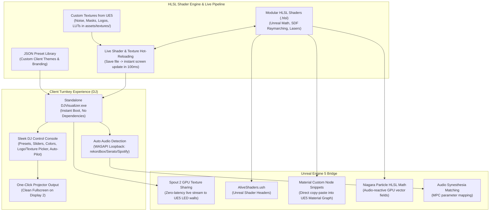

# DJ Audio-Reactive Visualizer & HLSL Live Pipeline

## Overview & Purpose
- **Deliverable Goal**: A turnkey, standalone, portable Windows application (`DJVisualizer.exe`) for your client (DJs / live performers) that runs out of the box with zero installation friction.
- **HLSL Live Shader Engine & Unreal Engine 5 Bridge**: Built with pure **HLSL** shaders using Unreal-style math, noise, and post-processing structures, featuring **live runtime hot-reloading**, **custom texture loading (PNG/JPG/TGA/HDR from UE5)**, **Spout 2 real-time GPU texture streaming** into UE5 virtual concert stages/LED walls, and exportable **UE5 Material Custom Nodes & `.ush` headers**.
- **GitHub Release Automation**: Fully automated GitHub Actions CI/CD workflow compiling and publishing portable `.zip` releases for instant client downloads.



---

## 1. Client-Facing Features (Turnkey DJ Tool)

### A. Zero-Configuration Audio Capture
- **Automatic System Audio Capture (WASAPI Loopback)**: Captures whatever is playing on the laptop (rekordbox, Serato, Traktor, Ableton, VirtualDJ, Spotify, browser) without requiring virtual cables or audio routing.
- **Mixer / Line-In Input**: Optional dropdown to select dedicated USB DJ mixer / audio interface input.
- **Real-Time DSP & Beat Tracking**: 5-band frequency tracking (Sub, Bass, LowMid, HighMid, Treble) + transient onset/beat-drop detector.

### B. Sleek DJ Live Dashboard (Dear ImGui)
- **Visualizer Themes**: One-click switching between curated scenes:
  1. *Alive Pyramid & LED Matrix* (Iconic glowing wireframe stage pyramid)
  2. *Tron Synthwave Horizon* (Endless vector grid terrain reacting to audio spectrum)
  3. *3D Raymarched Polyhedral Crystals* (Morphing geometric monoliths and fractal tunnels)
  4. *Concert Laser Matrix & Moving Heads* (Sweeping volumetric laser fans and stage blinders)
- **Live Performance Controls**:
  - Sliders for *Audio Reactivity*, *Bloom Glow*, *Glitch Burst Rate*, *Camera Speed*, *Wireframe Density*, and *Strobe Flash*.
  - *Color Palette Customizer*: Primary, Secondary, and Accent color pickers to match the event's theme or venue lighting.
  - *Logo & Custom Texture Selector*: Dropdown to pick or swap event logos and custom overlays.
- **Auto-Pilot Mode**:
  - Automatically switches scenes, intensifies strobes, and triggers camera shifts on drops so the DJ can play hands-free.
- **Preset Management**:
  - Save / Load named presets (saved as human-readable `.json` files).
- **One-Click Projector Output**:
  - Automatically detects connected projectors/external screens and launches a clean, borderless fullscreen window with zero UI clutter.

---

## 2. HLSL Shader Engine & Texture Pipeline

### A. Custom Textures from Unreal Engine
- Supports `.png`, `.jpg`, `.tga`, `.hdr`, `.dds` dropped directly into `assets/textures/`.
- Hot-reloads in-memory GPU textures upon file change.
- Standard texture registers in HLSL:
  - `t0`: `AudioDataTexture` (Real-time spectrum row 0, waveform row 1)
  - `t1`: `NoiseTexture` (Perlin / Blue noise / Normal map from UE5)
  - `t2`: `LogoTexture` (DJ Logo / Stage graphic mask)
  - `t3`: `ColorLUT` (Gradient ramp / Color grading LUT)
  - `t4`: `LensDirt` (Optical bloom & lens flare texture)

### B. Unreal-Style HLSL Shader Architecture
All shaders live in the `src/shaders/` directory as modular `.hlsl` files:
- **`Common.hlsl`**: Unreal-like math library (SDF shapes, 2D/3D Simplex & Voronoi noise, HSV-to-RGB, UV transforms, camera ray generation, smooth min/max).
- **Audio Texture & Uniforms**: Constant buffer `cbuffer AudioVisualizerParams : register(b0)` providing:
  - `Time`, `DeltaTime`, `Resolution`
  - `AudioSubBass`, `AudioKick`, `AudioLowMid`, `AudioHighMid`, `AudioTreble`
  - `BeatPulse`, `DropIntensity`, `EnergyAccumulator`
  - `CustomParam0` through `CustomParam7` (mapped directly to UI sliders)
  - `ColorPrimary`, `ColorSecondary`, `ColorAccent`

### C. Live Shader Hot-Reloading
- Edit any `.hlsl` file in VS Code or any text editor while the visualizer is running.
- Press **Ctrl+S** -> Visualizer automatically recompiles the shader in under 100ms.
- If there's a syntax error, it displays a non-intrusive on-screen compiler log without crashing the app.

---

## 3. Unreal Engine 5 Bridge & Integration (`ue5_bridge/`)

### A. Spout 2 Live Video Streaming to UE5
- Built-in Spout 2 / DirectX 11 Shared Texture sender.
- Allows real-time, zero-latency streaming of the visualizer into Unreal Engine 5 (via the Off-World Live / Spout plugin) to map onto virtual LED screens, 3D stadium backdrops, or virtual production stages.

### B. Material Editor Custom Node Snippets (`ue5_bridge/MaterialCustomNodes/`)
- Ready-to-copy HLSL snippets with pre-configured input/output pin definitions for the UE5 Material Graph:
  - `CustomNode_AlivePyramid.hlsl`
  - `CustomNode_SynthwaveGrid.hlsl`
  - `CustomNode_RaymarchedCrystals.hlsl`
  - `CustomNode_PostProcessGlitch.hlsl`

### C. Unreal Shader Header (`ue5_bridge/Shaders/AliveShaders.ush`)
- Formatted `.ush` header file ready to drop into your Unreal Engine project's `Shaders/` folder for use in Global Shaders, Custom Nodes, or Post-Process materials.

### D. Audio Parameter Matching (`ue5_bridge/UE5_Integration_Guide.md`)
- Complete mapping guide between visualizer audio uniforms and Unreal Engine 5's **Audio Synesthesia** plugin and **Material Parameter Collections (MPC)**.

### E. Niagara Particle HLSL Math (`ue5_bridge/Niagara/NiagaraAudioMath.hlsl`)
- Niagara-compatible math functions for driving audio-reactive GPU particle fields.

---

## 4. Tech Stack & Delivery Architecture
- **Language**: C++20 / Direct3D 11 (native DirectX for rock-solid 60/120 FPS performance, lightweight memory footprint, instant startup).
- **GUI**: Dear ImGui with custom dark DJ theme.
- **Audio**: Windows WASAPI COM API (sub-10ms latency).
- **Image Loading**: `stb_image` (embedded single-header loader for PNG, JPG, TGA, HDR, BMP).
- **CI/CD**: GitHub Actions workflow (`.github/workflows/release.yml`) for automated building and publishing `.zip` releases to GitHub.
- **Packaging**: Portable `.zip` containing `DJVisualizer.exe`, `shaders/`, `textures/`, and `presets/` that can be handed directly to your client.

---

## 5. Complete Directory Layout
```
C:/Git/visualizer/
├── .github/
│   └── workflows/
│       └── release.yml
├── assets/
│   └── textures/
│       ├── noise_perlin.png
│       ├── daft_alive_logo.png
│       ├── color_ramp_neon.png
│       └── lens_dirt.png
├── CMakeLists.txt
├── GEMINI.md
├── PLAN.md
├── README.md
├── src/
│   ├── main.cpp
│   ├── audio/
│   │   ├── WasapiAudioCapture.h / .cpp
│   │   ├── AudioAnalyzer.h / .cpp
│   │   └── BeatDetector.h / .cpp
│   ├── graphics/
│   │   ├── D3D11Renderer.h / .cpp
│   │   ├── ShaderCompiler.h / .cpp
│   │   ├── TextureManager.h / .cpp
│   │   ├── WindowManager.h / .cpp
│   │   ├── SpoutSender.h / .cpp
│   │   └── ConstantBuffers.h
│   ├── control/
│   │   ├── MidiController.h / .cpp
│   │   ├── PresetManager.h / .cpp
│   │   └── AutoPilot.h / .cpp
│   ├── ui/
│   │   └── DjDashboard.h / .cpp
│   └── shaders/
│       ├── Common.hlsl
│       ├── AlivePyramid.hlsl
│       ├── SynthwaveGrid.hlsl
│       ├── RaymarchedCrystals.hlsl
│       ├── ConcertLasers.hlsl
│       └── PostProcessGlitch.hlsl
├── ue5_bridge/
│   ├── UE5_Integration_Guide.md
│   ├── Shaders/
│   │   └── AliveShaders.ush
│   ├── MaterialCustomNodes/
│   │   ├── CustomNode_AlivePyramid.hlsl
│   │   ├── CustomNode_SynthwaveGrid.hlsl
│   │   ├── CustomNode_RaymarchedCrystals.hlsl
│   │   └── CustomNode_PostProcessGlitch.hlsl
│   └── Niagara/
│       └── NiagaraAudioMath.hlsl
└── scripts/
    ├── build.bat
    └── run.bat
```
